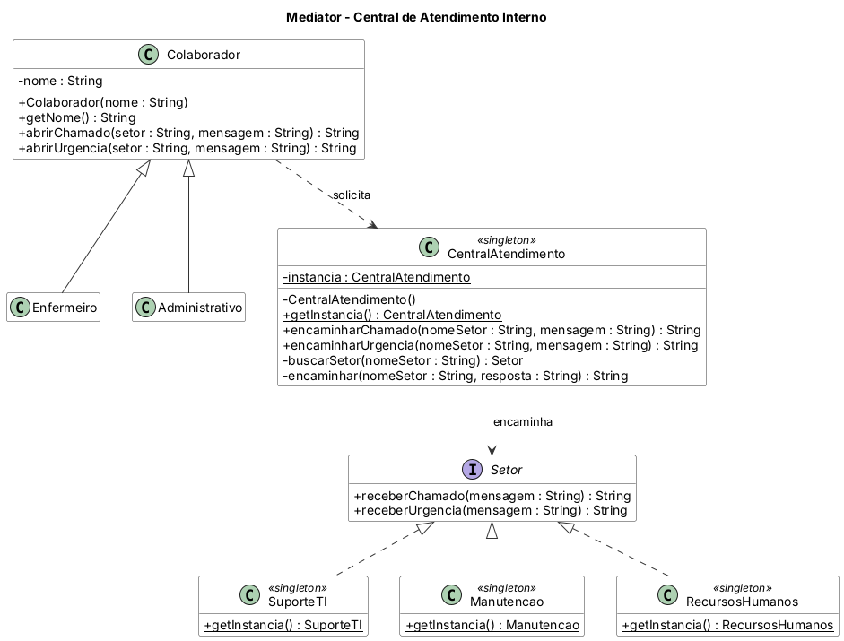

# Padrão Mediator

Aplicação de **central de atendimento interno** de um hospital. Colaboradores (Enfermeiro, Administrativo) não falam diretamente com os setores: abrem chamados ou urgências na `CentralAtendimento` (mediador), que encaminha ao setor correto — Suporte de TI, Manutenção ou RH — e devolve a resposta. Setor inexistente gera exceção.

## Diagrama de classes



O fonte do diagrama (PlantUML) está em `diagrama/diagrama-classes.puml`.

## Estrutura

- `src/main/java` — código-fonte
- `src/test/java` — casos de teste (JUnit 5)
- `diagrama/` — diagrama de classes

## Como executar os testes

```bash
mvn test
```

Ou abra o projeto no IntelliJ e rode a pasta `src/test/java`.

Java 11 · Maven · JUnit 5
